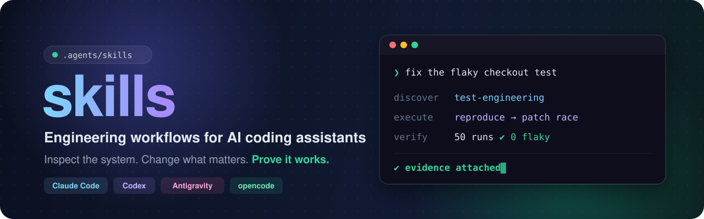
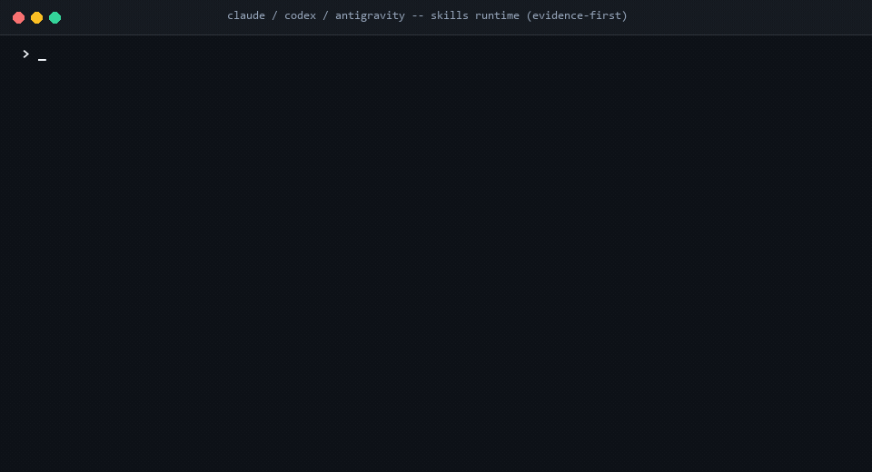
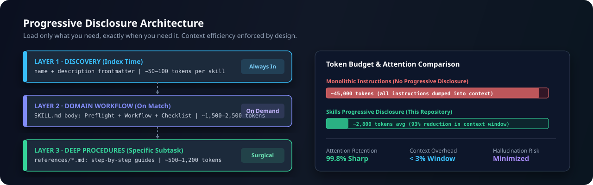
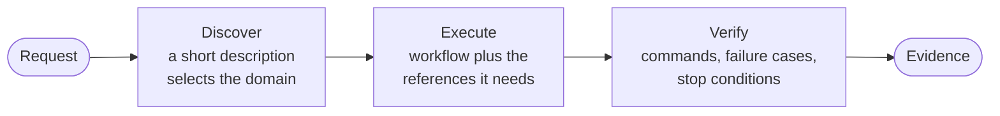
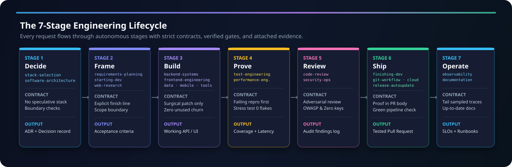
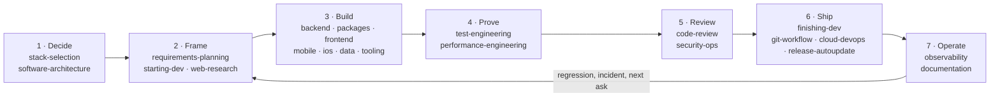

<div align="center">



# Engineering Skills · Evidence First

[](https://github.com/juninmd/skills/actions/workflows/validate.yml)
[](https://github.com/juninmd/skills/actions/workflows/security.yml)
[](./LICENSE)
[](#claude-code-plugin)
[](https://agentskills.io)
[](https://modelcontextprotocol.io)

**32 skills · enterprise operating instructions**

*Production engineering workflows for AI coding assistants: discover intent, execute surgical changes, and prove with reproducible evidence.*

[🧭 Skill catalog](#skill-catalog) · [🚀 Get started](#get-started) · [🤖 Multi-agent ecosystem](#autonomous-multi-agent-ecosystem) · [📐 Lifecycle](#where-each-skill-fits-in-the-cycle) · [📜 Standards](#specifications-and-standards) · [🛡️ Quality checks](#quality-checks) · [🤝 Contributing](#contributing)

<br/>



</div>

---

## From request to evidence

<div align="center">
  
</div>



Each skill covers a whole domain instead of a single trick. Its main workflow stays short; detailed procedures live beside it in `references/` and load only when the task needs them.

<table>
<tr>
<td width="33%" valign="top">

**🧭 Routed, not recited**

A one-line description picks the domain. No instruction file has to name a skill for it to load.

</td>
<td width="33%" valign="top">

**📦 Loaded on demand**

Short workflows up front, deep references beside them. Token budgets are enforced in CI.

</td>
<td width="33%" valign="top">

**✅ Done means proven**

Workflows end in a check you run: a test, a smoke command, or an explicit stop condition.

</td>
</tr>
</table>

## Get started

Pick **one** install method per client.

| Method | Clients | Stays in sync with the repo | Includes operating instructions |
|---|---|---|---|
| [Symlink install](#symlink-install) | Claude Code, Codex, Antigravity, opencode | yes, live | instructions and configs |
| [Claude Code plugin](#claude-code-plugin) | Claude Code | after `marketplace update` and reinstall | — |
| [Skills CLI](#skills-cli) | any client the CLI supports | no, files are copied | no |

### Symlink install

One canonical checkout, linked into every client. Edits in the repo are live everywhere; nothing is copied.

```bash
git clone https://github.com/juninmd/skills && cd skills
node .agents/tools/install.mjs --dry-run   # show the plan
node .agents/tools/install.mjs all         # or: claude | codex | agy | opencode
```

| Client | Skills | Instructions | Config |
|---|---|---|---|
| Claude Code | `~/.claude/skills/<name>` | `~/.claude/CLAUDE.md` | `~/.claude/settings.json` |
| Codex | `~/.codex/skills/<name>` | `~/.codex/AGENTS.md` | `~/.codex/config.toml` |
| Antigravity (agy) | `~/.gemini/config/skills/<name>` | `~/.gemini/GEMINI.md` | — |
| opencode | `~/.config/opencode/skills/<name>` | — | — |

> [!NOTE]
> Instruction files link to [`.agents/AGENTS.md`](.agents/AGENTS.md); configs link to [`.agents/clients/`](.agents/clients/), tuned for low token use. Existing real files are renamed to `*.bak-<timestamp>` first. Pass `--no-config` to link skills and instructions only.

<details>
<summary><b>What the installer changes, and Windows specifics</b></summary>

<br/>

- Configs are tuned for low token use: collapsed skill listings, bounded tool output, 1h prompt cache, auto-compact.
- Links to retired skills are pruned on every run.
- On Windows, skill directories become junctions, which need no privilege. File links need Developer Mode or an elevated shell. Without either, `CLAUDE.md` and `GEMINI.md` get a one-line `@path` import stub that tracks the repo the same way, and the config files are left untouched until you rerun elevated.

</details>

### Claude Code plugins

Install either the full bundle or only the domains you need from the [`.claude-plugin/marketplace.json`](.claude-plugin/marketplace.json) marketplace:

| Plugin | Context & Scope | Included Skills |
|---|---|---|
| `juninmd@skills` | **Complete Bundle** | All 32 skills |
| `juninmd-core@skills` | **Core Lifecycle & Quality** | `starting-dev`, `finishing-dev`, `git-workflow`, `requirements-planning`, `code-review`, `test-engineering`, `documentation` |
| `juninmd-web@skills` | **Frontend & Mobile** | `frontend-engineering`, `mobile-engineering`, `ios-engineering`, `stack-selection`, `motion-video`, `threejs`, `3d-models` |
| `juninmd-backend@skills` | **Backend, Data & Architecture** | `backend-systems`, `data-engineering`, `software-architecture`, `package-management`, `tooling-dev`, `bot-engineering`, `goldsrc-modding` |
| `juninmd-devops@skills` | **Cloud, DevOps & Security** | `cloud-devops`, `observability`, `performance-engineering`, `security-ops`, `release-autoupdate` |
| `juninmd-ai@skills` | **AI Agents & Ecosystem** | `agent-engineering`, `agent-orchestration`, `skill-authoring`, `web-research`, `radar-ia`, `agy-image-babysitter` |

```bash
claude plugin marketplace add juninmd/skills            # or a local checkout path

# Install the full bundle:
claude plugin install juninmd@skills                    # --scope user | project | local

# Or install targeted contextual plugins:
claude plugin install juninmd-web@skills
claude plugin install juninmd-devops@skills

claude plugin details juninmd@skills                    # inventory and always-on token cost
```

> [!IMPORTANT]
> Claude Code copies plugins into `~/.claude/plugins/cache`. To pick up repo edits, run `claude plugin marketplace update skills` and reinstall. Updates follow the default branch unpinned, so read the diff before updating.

Claude Code uses one install method at a time. While `juninmd@skills` is installed, `install.mjs claude` removes the skill links that point into this repo and skips creating new ones, so no skill loads twice. To switch back, run `claude plugin uninstall juninmd@skills`, then `node .agents/tools/install.mjs claude`.

### Skills CLI

```bash
npx skills add juninmd/skills --list                    # inspect the catalog
npx skills add juninmd/skills --skill backend-systems   # copy one domain
```

The CLI copies files; it does not track the repo or install the repository operating instructions.

## Pick a starting point

| | Your task | Start with |
|---|---|---|
| 🧭 | Understand an unfamiliar repository or clarify a request | [starting-dev](.agents/skills/starting-dev/SKILL.md) |
| 🛠️ | Build a service or endpoint | [backend-systems](.agents/skills/backend-systems/SKILL.md) |
| 🎨 | Build an accessible web interface | [frontend-engineering](.agents/skills/frontend-engineering/SKILL.md) |
| 🔎 | Investigate failures and incidents | [observability](.agents/skills/observability/SKILL.md) |
| 🧐 | Review a change or simplify code | [code-review](.agents/skills/code-review/SKILL.md) |
| 🔐 | Audit credentials and trust boundaries | [security-ops](.agents/skills/security-ops/SKILL.md) |
| 🚢 | Ship a finished branch as a PR | [finishing-dev](.agents/skills/finishing-dev/SKILL.md) |

## Consolidated skill ownership

Review and security work belongs to `code-review` and `security-ops`; planning belongs to `requirements-planning`; repository orientation and implementation execution belong to `starting-dev`. See the [custom-agent migration map](docs/migration-agents-to-skills.md) for the complete mapping.

### Enterprise operating guardrails

All skills operate under four non-negotiable hats with explicit veto priority:

1. **SecOps (Veto)**: Zero secrets in git/logs, least-privilege tokens, OWASP Top 10 defenses, supply chain integrity.
2. **QA (Proof)**: Every behavior change requires a failing reproduction before patching; flaky tests are treated as broken.
3. **DevOps (Ship)**: Every deployable change includes a rollback plan, health check, and passing automated pipeline.
4. **SWE (Build)**: Surgical diffs, no N+1 queries, bounded loops, paginated responses, and SOLID principles.

## Where each skill fits in the cycle

You never invoke a skill by name: a one-line description routes the request. What
follows is *when* each domain owns the work, so you can tell whether the right one
picked up the task, and name it yourself when it did not.

<div align="center">
  
</div>



| Stage | You are about to | Skill | It leaves behind |
|---|---|---|---|
| **1 · Decide** | Pick a language, runtime, framework, database, or replace a dependency | [`stack-selection`](.agents/skills/stack-selection/SKILL.md) | The pick, the rejected alternative, and the condition that reverses it |
| | Draw module boundaries, a domain model, or an ADR | [`software-architecture`](.agents/skills/software-architecture/SKILL.md) | Boundaries and dependency directions |
| **2 · Frame** | Turn a vague ask into acceptance criteria, a PRD, a finish line, or vertical slices | [`requirements-planning`](.agents/skills/requirements-planning/SKILL.md) | Criteria you can test against |
| | Onboard to an unfamiliar repo, write AGENTS.md, run the research-prototype-plan loop | [`starting-dev`](.agents/skills/starting-dev/SKILL.md) | A map of the codebase and a plan |
| | Verify a claim, a version, or prior art before committing to it | [`web-research`](.agents/skills/web-research/SKILL.md) | Cited, dated evidence |
| **3 · Build** | Write a service, endpoint, or background job | [`backend-systems`](.agents/skills/backend-systems/SKILL.md) | Working code and its contract |
| | Add, upgrade, or migrate packages, lockfiles, pnpm workspaces, or uv projects | [`package-management`](.agents/skills/package-management/SKILL.md) | A reproducible install and a clean lockfile |
| | Write web UI, components, or layout | [`frontend-engineering`](.agents/skills/frontend-engineering/SKILL.md) | An accessible, state-complete interface |
| | Write a mobile screen or device integration | [`mobile-engineering`](.agents/skills/mobile-engineering/SKILL.md) | A screen that survives lifecycle and permissions |
| | Write Swift, SwiftUI, UIKit, Metal, or WidgetKit code | [`ios-engineering`](.agents/skills/ios-engineering/SKILL.md) | Native code that follows the platform guidelines |
| | Write queries, schema, or migrations | [`data-engineering`](.agents/skills/data-engineering/SKILL.md) | A reversible migration and a checked query plan |
| | Build a CLI, generator, or internal automation | [`tooling-dev`](.agents/skills/tooling-dev/SKILL.md) | A non-interactive tool with honest exit codes |
| | Build agents, MCP servers, or their system prompts | [`agent-engineering`](.agents/skills/agent-engineering/SKILL.md) | Tool schemas, bounded loops, and a failure matrix |
| | Fan work out to subagents, verify their claims, or run a long unattended task | [`agent-orchestration`](.agents/skills/agent-orchestration/SKILL.md) | Per-unit evidence and a task file |
| | Write, split, or tune a skill and its routing evals | [`skill-authoring`](.agents/skills/skill-authoring/SKILL.md) | A skill that wins its own prompts |
| **4 · Prove** | Add or repair tests, eliminate a flake | [`test-engineering`](.agents/skills/test-engineering/SKILL.md) | A test that fails for the right reason |
| | Chase latency, memory, Core Web Vitals, or spend | [`performance-engineering`](.agents/skills/performance-engineering/SKILL.md) | Before and after against a budget |
| **5 · Review** | Review a diff adversarially, or simplify working code | [`code-review`](.agents/skills/code-review/SKILL.md) | Findings with file, line, and impact |
| | Audit secrets, permissions, dependencies, trust boundaries | [`security-ops`](.agents/skills/security-ops/SKILL.md) | The threat surface and the safer fix |
| **6 · Ship** | Prepare and open the pull request with its evidence | [`finishing-dev`](.agents/skills/finishing-dev/SKILL.md) | A PR body carrying screenshots and payloads |
| | Rebase, recover a commit, resolve a conflict, tag a release | [`git-workflow`](.agents/skills/git-workflow/SKILL.md) | A verified remote SHA |
| | CI, containers, infrastructure, rollout | [`cloud-devops`](.agents/skills/cloud-devops/SKILL.md) | A pipeline and a rollback path |
| | Multi-platform releases, artifact signing, updater manifests | [`release-autoupdate`](.agents/skills/release-autoupdate/SKILL.md) | Signed binaries and updater manifest |
| **7 · Operate** | Instrument, read a trace, diagnose an incident | [`observability`](.agents/skills/observability/SKILL.md) | Log, metric, alert, runbook |
| | Write the README, diagram, or API reference the change requires | [`documentation`](.agents/skills/documentation/SKILL.md) | Docs that match the shipped behavior |

Seven skills sit outside the cycle and load whenever their subject appears:
[`radar-ia`](.agents/skills/radar-ia/SKILL.md) for AI ecosystem digests,
[`bot-engineering`](.agents/skills/bot-engineering/SKILL.md) for scheduled scraper and notification bots,
[`3d-models`](.agents/skills/3d-models/SKILL.md) and [`threejs`](.agents/skills/threejs/SKILL.md)
for 3D assets and scenes, [`goldsrc-modding`](.agents/skills/goldsrc-modding/SKILL.md),
[`motion-video`](.agents/skills/motion-video/SKILL.md) for code-rendered motion graphics,
and [`agy-image-babysitter`](.agents/skills/agy-image-babysitter/SKILL.md).

Every skill body opens with a **Not this skill** line naming the neighbors that own
the work it does not. When a handoff is wrong, that line is where to look first.

### One request, end to end

```text
"I need a screen showing each customer's orders"
  starting-dev           who reads it, what counts as an order, what success is
  stack-selection        TanStack Query is already here; no new dependency
  data-engineering       index on (customer_id, created_at), query plan checked
  backend-systems        GET /v1/customers/:id/orders, paginated, validated at the edge
  frontend-engineering   loading, empty, error, and offline states
  test-engineering       a test that fails without the index and passes with it
  code-review            defects and contract regressions
  security-ops           can one customer read another one's orders?
  finishing-dev          a PR with a screenshot per state and the endpoint payload
  observability          a latency metric and an alert on the new endpoint
```

Each step is a handoff the skills make themselves: a workflow ends by naming the
domain that owns what comes next. You keep writing prose.

## Skill catalog

<!-- skill-catalog:start -->
| Skill | Use it for |
|---|---|
| `3d-models` | Blender cleanup, VRM 0.x/1.0 conversion, VRoid exports, MToon materials, shape keys, ARKit blendshapes, humanoid rigs, VRM SpringBone hair physics, and Blender MCP automation |
| `agent-engineering` | agent loops, tool schemas, step and token bounds, prompt-injection defense, tool guards and hooks, MCP transports, context pruning, and system prompts for Claude 5 models |
| `agent-orchestration` | fan-out subagents in isolated workspaces, dynamic workflows, adversarial verification, tournaments, model councils, stop rules with a task file, and headless runs through auth expiry and quotas |
| `agy-image-babysitter` | Keep an agy (Antigravity CLI) conversation generating images unattended: relaunch the headless loop 90s after a 401 token expiry and sleep until quotaResetTimeStamp after a 429 |
| `backend-systems` | NestJS modules, DI, DTO validation, FastAPI, REST/GraphQL OpenAPI contracts, endpoints and controllers, async concurrency, and cache invalidation |
| `bot-engineering` | dedupe/seen-state, rate-limit backoff, keyless endpoints, CronJob scheduling, Telegram/Discord/WhatsApp delivery, and optional LLM steps |
| `cloud-devops` | GitHub Actions, Dockerfiles, Terraform, Helm, canary and feature flag rollouts, manual GHCR rollout, deployment sync drift, and safe bash/PowerShell |
| `code-review` | adversarial review, sibling bug variants, legacy code recovery, characterization tests, simplifying working code, and deleting proven dead code |
| `data-engineering` | PostgreSQL, MySQL, Redis, schema migrations, zero-downtime DDL, query plans, indexes, backups and point-in-time restore, pandas profiling, and aggregation |
| `documentation` | README, docs verification, Mermaid diagrams as code, ASCII and terminal figures, code snippet images, PDF/DOCX generation, and OpenAPI reference |
| `finishing-dev` | PR delivery, descriptions, acceptance evidence, homologação (prove it on the real target), and return to the default branch with or without pipeline monitoring |
| `frontend-engineering` | React, Next.js, Vite, Tailwind, WCAG accessibility, i18n and RTL, visual hierarchy, color palettes, anti-slop styling, animation, easing, motion, UI states, and masonry |
| `git-workflow` | branches, worktrees, rebase conflicts, reflog recovery, stash, bisect, conventional commits, semantic version bumps, changelogs, and release tags |
| `goldsrc-modding` | Valve 220 .map geometry, ZHLT/VHLT compiles, BSP30 lumps, CS 1.6 entities, and Pawn (.sma/.amxx) natives, forwards, precache, and crash forensics |
| `ios-engineering` | Swift optionals, concurrency and memory, SwiftUI views, UIKit and Auto Layout, Metal shaders, WidgetKit, iOS permissions and system integration, and App Store readiness |
| `mobile-engineering` | React Native, Expo, Flutter, and native Android UI, lifecycle, navigation, permissions, offline behavior, accessibility, localization, device integration, tests, and builds |
| `motion-video` | reels, shorts, product-news and kinetic-typography videos, 'a video like this reel', adding music to a render |
| `observability` | root-cause debugging, logging, metrics, distributed tracing, alerting, SLOs and error budgets, postmortems, network failures, timeouts, on-call, product event tracking, and A/B experiments |
| `package-management` | pnpm workspaces, catalogs, overrides, patches, and peer deps; uv, pyproject.toml, PEP 723 scripts, Ruff, prek/pre-commit, Dependabot update PRs, lockfile hygiene, and CI install caching |
| `performance-engineering` | endpoint profiling, k6 load tests, bottlenecks, N+1 queries, memory leaks, LCP/INP, autonomous metric loops, and rightsizing costs |
| `radar-ia` | the daily AI radar and best-posts digests; not for one-paper research or debugging |
| `release-autoupdate` | multi-platform release jobs, minisign artifact signing, conventional commit version bumps, updater manifests, and in-app update checks |
| `requirements-planning` | acceptance criteria, PRDs and specs, implementation briefs with finish lines, vertical-slice backlog issues, and triage of incoming issues |
| `security-ops` | vulnerability audits, pen tests, CVE scans, Gitleaks remediation, least privilege, threat modeling, LGPD/GDPR privacy, and plugin or MCP server vetting |
| `skill-authoring` | a new SKILL.md, gotchas sections, progressive-disclosure references, skill scripts and persistent data, splitting a skill that straddles domains, and deciding whether a recurring task deserves a skill |
| `software-architecture` | module boundaries, ubiquitous language and CONTEXT.md glossaries, repository layout, Electron multi-process security, ADRs, and circular dependencies |
| `stack-selection` | TypeScript, Bun versus Node, pnpm, uv, NestJS, Biome, Scalar versus Swagger, an LLM SDK, Tauri versus Electron, picking a package manager, framework, ORM, linter, or UI library (toasts), and adopting or replacing a dependency |
| `starting-dev` | AGENTS.md or CLAUDE.md project instructions and README, onboarding by charting an unfamiliar codebase and its dependencies, the dev loop (research, throwaway prototypes, plan, implement), worktrees awaiting PRs, task stages, session handoffs |
| `test-engineering` | unit and integration tests, Vitest, pytest, Playwright E2E, flaky test elimination, LLM gateway conformance, and coverage |
| `threejs` | GLTF/GLB model viewers, cameras, lighting, raycasting, shaders, animation, WebGL/WebGPU rendering, asset loading, scene performance, and GPU resource cleanup |
| `tooling-dev` | CLI arguments, exit codes, non-interactive execution, config discovery, signals, structured output, packaging, and integration tests |
| `web-research` | multi-source search, HTML table and listing scraping, latest stable library versions, changelog tracking, and citations |
<!-- skill-catalog:end -->

### Architectural domain guide

Skills in this repository are organized into six engineering pillars, each designed to solve distinct concerns with surgical isolation and zero overlap:

#### 1. Architecture, Strategy & Tech Selection
- [`stack-selection`](.agents/skills/stack-selection/SKILL.md): Evaluates runtime tradeoffs (e.g. Bun vs Node, NestJS vs FastAPI, Biome vs ESLint) before code exists. Leaves behind the chosen pick, the rejected alternative, and the exact reversal condition.
- [`software-architecture`](.agents/skills/software-architecture/SKILL.md): Enforces clean domain boundaries, dependency inversion, and architectural decision records (ADRs). Leaves behind module boundaries and dependency direction maps.
- [`requirements-planning`](.agents/skills/requirements-planning/SKILL.md): Deconstructs vague requests into testable acceptance criteria, PRDs, and vertical slices.
- [`starting-dev`](.agents/skills/starting-dev/SKILL.md): Onboards assistants to unfamiliar repositories, creates project instruction files, and sets up worktrees.
- [`web-research`](.agents/skills/web-research/SKILL.md): Conducts resilient multi-source searches and verifies library releases, documentation, and migration guides before committing changes.

#### 2. Fullstack & Systems Engineering
- [`backend-systems`](.agents/skills/backend-systems/SKILL.md): Designs robust APIs, NestJS modules, FastAPI routes, OpenAPI contracts, and cache invalidation strategies without N+1 queries.
- [`frontend-engineering`](.agents/skills/frontend-engineering/SKILL.md): Crafts modern web user interfaces in React, Next.js, and Tailwind with complete state handling (loading, empty, error) and strict WCAG accessibility.
- [`data-engineering`](.agents/skills/data-engineering/SKILL.md): Manages PostgreSQL and MySQL schemas, zero-downtime DDL, reversible migrations, query optimization, and point-in-time recovery.
- [`mobile-engineering`](.agents/skills/mobile-engineering/SKILL.md): Builds cross-platform applications in React Native, Expo, and Flutter with deep lifecycle and offline support.
- [`ios-engineering`](.agents/skills/ios-engineering/SKILL.md): Implements native Swift, SwiftUI, UIKit, Metal, and WidgetKit apps matching Apple's Human Interface Guidelines.
- [`tooling-dev`](.agents/skills/tooling-dev/SKILL.md): Develops non-interactive developer CLI tools, code generators, and automation scripts with honest exit codes.
- [`package-management`](.agents/skills/package-management/SKILL.md): Maintains clean pnpm catalogs, uv lockfiles, and peer dependency trees.

#### 3. Quality Assurance, Performance & Observability
- [`test-engineering`](.agents/skills/test-engineering/SKILL.md): Mandates reproducing bugs before touching code, quarantines flaky tests, and asserts business invariants across Vitest, pytest, and Playwright.
- [`performance-engineering`](.agents/skills/performance-engineering/SKILL.md): Diagnoses latency bottlenecks, memory leaks, and Core Web Vitals using open-loop load testing and rigorous before/after budgets.
- [`observability`](.agents/skills/observability/SKILL.md): Instruments applications with OpenTelemetry semantic conventions, tail-sampled traces, metrics, alerts, and SLO error budgets.
- [`documentation`](.agents/skills/documentation/SKILL.md): Produces clear Diátaxis-structured technical documentation, verified diagrams, and OpenAPI contracts.

#### 4. Security, Adversarial Review & Autonomous Delivery
- [`code-review`](.agents/skills/code-review/SKILL.md): Acts as an adversary on every diff, hunting boundary errors, regressions, and dead code using structured severity rankings (Blocker, Major, Minor, Nit).
- [`security-ops`](.agents/skills/security-ops/SKILL.md): Audits trust boundaries, validates inputs, eliminates secret leaks, and enforces OWASP Top 10 security standards.
- [`finishing-dev`](.agents/skills/finishing-dev/SKILL.md): Validates full test suites, gathers screenshots and payload evidence, and opens comprehensive pull requests.
- [`git-workflow`](.agents/skills/git-workflow/SKILL.md): Operates advanced Git workflows: branch isolation, worktrees, bisect, reflog recovery, and signed conventional commits.
- [`cloud-devops`](.agents/skills/cloud-devops/SKILL.md): Configures hardened GitHub Actions, Dockerfiles, Kubernetes manifests, and Terraform IaC with explicit rollback plans.
- [`release-autoupdate`](.agents/skills/release-autoupdate/SKILL.md): Automates multi-platform desktop/CLI releases with minisign artifact signing and in-app updater manifests.

#### 5. AI Runtimes, Context & Multi-Agent Loops
- [`agent-engineering`](.agents/skills/agent-engineering/SKILL.md): Engineers agent runtimes, tool schemas, fail-closed hook guards, step/token boundaries, and prompt-injection defenses.
- [`agent-orchestration`](.agents/skills/agent-orchestration/SKILL.md): Coordinates parallel subagent fan-outs, tournament validations, model councils, and long-running headless loops.
- [`skill-authoring`](.agents/skills/skill-authoring/SKILL.md): Authors, splits, and tunes agent skills with progressive-disclosure references and offline lexical evaluation benchmarks.
- [`agy-image-babysitter`](.agents/skills/agy-image-babysitter/SKILL.md): Maintains headless CLI agent execution across authentication token expirations and API rate limits.
- [`radar-ia`](.agents/skills/radar-ia/SKILL.md): Sweeps trending AI engineering releases, research papers, and tool changelogs into curated digests.

#### 6. Specialized Systems & Creative Automation
- [`3d-models`](.agents/skills/3d-models/SKILL.md): Prepares, cleans, and converts VRM avatars, Blender assets, and blendshapes.
- [`threejs`](.agents/skills/threejs/SKILL.md): Builds interactive WebGL/WebGPU 3D model viewers and GPU-optimized scenes.
- [`motion-video`](.agents/skills/motion-video/SKILL.md): Generates programmatic motion-graphics videos via frame-by-frame HTML/CSS rendering.
- [`bot-engineering`](.agents/skills/bot-engineering/SKILL.md): Builds reliable scheduled scrapers, monitors, and Telegram/Discord notification bots with backoff and deduplication.
- [`goldsrc-modding`](.agents/skills/goldsrc-modding/SKILL.md): Compiles Valve 220 maps, BSP lumps, and AMX Mod X Pawn plugins.

### Anatomy of a skill (The House Contract)

Every skill adheres to a strict, standardized anatomy designed for predictable execution:

```
.agents/skills/<name>/
├── SKILL.md             # Discovery metadata, preflight, core workflow, stop rules
└── references/          # Deep procedures loaded only when a specific subtask triggers
    ├── TOPIC_MAP.md     # One-hop directory of procedures
    └── <procedure>.md   # Surgical commands, checklists, and code snippets
```

| Section | Purpose & Operational Guarantee |
|---|---|
| `## Preflight` | Probes host OS, runtime version, and working tree before making any changes. |
| `## Workflow` | Numbered sequential steps; every step produces tangible progress. |
| `## Decision Table` | Explicit conditions mapping detected system states to exact operational branches. |
| `## Real Command Blocks` | Real, non-interactive shell commands bounded by timeouts and quiet flags. |
| `## Stop Rules` | Hard circuit breakers: halts after 3 consecutive errors to prevent hallucination thrashing. |
| `## Rules` | Non-negotiable boundaries: zero secrets, surgical patches, bounded loops, fail-closed guards. |
| `## Checklist` | Verifiable binary criteria that prove completion before handoff. |

## Beyond skills

| Resource | Purpose |
|---|---|
| [Shared operating instructions](.agents/AGENTS.md) | Hats, confirmation table, rules, validation gates, and the final report format |
| [Client configs](.agents/clients/) | Token-optimized `settings.json` (Claude Code) and `config.toml` (Codex) |
| [Repository contract](./AGENTS.md) | How to maintain and validate this catalog |

## Specifications and standards

This repository strictly conforms to official agent engineering specifications:

| Specification | Standard / Authority | Implementation in this repository |
|---|---|---|
| **Agent Skills** | [agentskills.io](https://agentskills.io) | Strict frontmatter schema (`name`, `description`, `metadata`, `compatibility`), progressive disclosure, and house structure (`Preflight`, `Workflow`, `Rules`, `Checklist`). |
| **Agent Hooks** | Claude Code & Runtime Hooks | Lifecycle interceptors (`PreToolUse` blocks on exit code 2, a JSON `deny`, or a JSON `continue: false`, so guards exit 2 on every error path; `PostToolUse` sanitization), deterministic barriers, and scoped tool matchers. |
| **Model Context Protocol** | [modelcontextprotocol.io](https://modelcontextprotocol.io) | Typed JSON schemas for tools, URI-identified resources, structured prompts, and fail-closed circuit breakers. |

## Quality checks

From a checkout with Node.js and pnpm available:

```bash
pnpm install --frozen-lockfile
pnpm run validate
pnpm run docs:build
```

| Check | Evidence it provides |
|---|---|
| Structure | Valid frontmatter, skill names, required sections, and local references |
| Catalog | README and docs tables match the skill descriptions |
| Budgets | Descriptions and skill bodies stay within the configured limits |
| Routing | Offline lexical ranking of positive and negative prompts |
| Retired names | No skill or instruction still hands off to a merged skill by its old name |
| Approved domains | Every http(s) host a skill cites is listed, with a reason, in [`.agents/approved-domains.toml`](.agents/approved-domains.toml) |
| Documentation | Spelling, relative links, and a buildable documentation site |
| Validator tests | Regression checks for the validation tools |

> [!WARNING]
> Passing checks are necessary, but they do not prove assistant behavior. Routing uses a deterministic lexical scorer and does not run the target assistants. Exercise representative tasks in each client before claiming compatibility.

Inspect detailed reports with `pnpm run evals` and `pnpm run tokens:report`. Budget limits live in the validation tools rather than in a duplicated table here.

## Practice review, October 2026

Changes come from a review of current primary sources (checked 2026-10-10) and a repo-fit check of each proposal. Claims that could not be confirmed are listed under Not executed here or Open follow-ups.

| Skill | Change | Why (source) |
|---|---|---|
| `git-workflow` | Signing checks read rulesets as well as classic branch protection | GitHub Docs: rulesets and classic rules apply together; a classic-only check misses signing rules |
| `performance-engineering` | CrUX covers only opted-in desktop and Android Chrome, so iPhone p75 needs RUM; RUM uses `web-vitals`; load tests distinguish closed and open models | CrUX methodology; `web-vitals` README; k6 docs. Closed loops hide tail latency (coordinated omission) |
| `data-engineering` | Batched backfill rewritten, since `UPDATE` takes no `LIMIT`; non-volatile defaults are metadata-only; `NOT NULL` through a `NOT VALID` check; a re-run of `CREATE INDEX CONCURRENTLY` fails loudly on an invalid index | PostgreSQL docs: `UPDATE`, `ALTER TABLE`, `CREATE INDEX` |
| `package-management` | `uv sync --locked` in CI; pnpm `allowBuilds` replaces the keys pnpm 11 removed; `minimumReleaseAge` as a release-age gate; Node 20 pins moved to 24 | Astral uv docs; pnpm settings and 11.0 notes; Node.js release schedule (Node 20 ended 2026-04-30) |
| `mobile-engineering`, `ios-engineering` | Android `targetSdk` 36 for new apps, with the device exceptions; edge-to-edge as its own section; a privacy-manifest checklist line | Google Play target API requirements; Android edge-to-edge docs; Apple privacy manifest notice |
| `code-review` | Design is the first review pass; one severity scale (Blocker, Major, Minor, Nit) across the skill, the reviewer agent, and its docs | Google engineering practices: review the design first |
| `test-engineering` | A flaky test is quarantined, never skipped, with an owner and a ticket; Vitest 4 uses `maxWorkers`, since `poolOptions` was removed | Apache KIP-1090 as an example policy; Vitest 4 migration guide |
| `security-ops` | Findings carry OWASP Top 10:2025 categories, Application Security Verification Standard 5.0 chapters, and API Top 10 tags; `gitleaks git` and `gitleaks dir` replace the deprecated `detect` | OWASP Top 10:2025; OWASP Application Security Verification Standard 5.0; gitleaks README |
| `cloud-devops` | CI template with read-only token permissions and pinned actions; a restricted Pod Security section; a rollback burn-rate threshold tied to a 30-day budget; native S3 state locking | GitHub secure-use reference; Kubernetes Pod Security Standards; Google SRE Workbook; Terraform S3 backend docs |
| `observability` | Tail sampling is the only way to keep every error trace; stable OpenTelemetry HTTP attribute names; an SLO budget policy with an owner and a review date | OpenTelemetry sampling and HTTP semantic conventions; Google SRE Workbook |
| `agent-engineering` | `PreToolUse` blocks only on exit code 2 or JSON `deny`, so guards fail closed on every error path; MCP tokens are audience-bound and never passed through; evals grade outcomes and report pass^k | Claude Code hooks reference; MCP security best practices (2026-07-28); Anthropic eval guide |
| `frontend-engineering` | Next.js 16 async request APIs and `cacheComponents`-dependent caching; `getServerSnapshot` for `useSyncExternalStore`; WCAG 2.2 criteria 2.5.7, 3.2.6, and 3.3.7 | Next.js 16 docs; React reference; W3C WCAG 2.2 |
| `starting-dev`, `skill-authoring` | `AGENTS.md` is skipped when a `CLAUDE.md` exists unless it is imported; the six-key frontmatter rule is stated as house policy, stricter than Claude Code | Claude Code memory and skills docs |
| `finishing-dev`, `starting-dev` | The default-branch return survives an unset `origin/HEAD`; `git branch -d` refuses a squash-merged branch unless its upstream still holds the tip; the branch is then removed only when a merged PR head equals the local tip | git-scm.com `git-remote` and `git-branch`; local reproduction with git 2.43 |
| `web-research` | `cargo search` results may be pre-releases; the version string shows it | Cargo book: specifying dependencies |
| `documentation`, `requirements-planning`, `software-architecture` | Diátaxis modes described as the framework defines them; Given/When/Then acceptance criteria; ADRs record how the decision is confirmed | diataxis.fr; Gherkin reference; MADR 4.0.0 template |

**Deliberately not changed**

- Conventional Comments labels: they would add a second severity vocabulary beside the one above.
- Trace on first retry: not wrong. Playwright recommends it for CI.
- pnpm 12 and a newer `pnpm/action-setup`: the lockfile-rewrite caveat is unverified, so the pin stays until it is.
- The hook `onFailure` setting, its Claude Code version, and the MCP claim that revision 2026-07-28 removed sessions: no source confirmed them.

**Not executed here**

The gitleaks commands (the binary is not installed), the PostgreSQL SQL, the `gh api` rules filter against a ruleset response, and the uv and pnpm commands. Run them once before relying on them.

**Open follow-ups**

- `package-management/references/pep723-scripts.md`: the "no lockfile" claim conflicts with `uv lock --script`.
- `backend-systems/references/backend-python.md` and `web-research/references/knowledge-freshness.md` still use `--frozen` in CI examples.
- Package-management pins: `pnpm/action-setup` v9 and `packageManager` `pnpm@9.0.0`.
- `web-performance.md` Rules and the RUM note; the ADR row in `documentation/SKILL.md`; the iOS privacy-manifest routing line in `ios-engineering/SKILL.md`.
- `performance-engineering/SKILL.md`: the preflight still runs the closed-loop `autocannon -c 50` baseline; label it or add a fixed-rate run.
- `test-engineering/SKILL.md` says never retry a flaky test, while `core-test-api.md` shows `retry: 3` and `ui-review.md` uses `on-first-retry`.
- `requirements-planning/references/AGENT-BRIEF.md` still uses bullet acceptance criteria.

## Contributing

1. Edit the owning domain under `.agents/skills/<name>/`.
2. Keep the main workflow actionable; link specialist procedures from `references/`. Naming a sibling skill is optional; naming a retired skill is an error.
3. When merging or renaming, add the old name to `.agents/retired-skills.json`, then update callers, reference maps, eval owners, agents, and installation examples.
4. Add realistic positive prompts and negative prompts with their correct owner. Preserve failing cases when fixing descriptions.
5. Regenerate the catalog with `pnpm run catalog:generate`, then run the quality checks above.

Keep one canonical skill tree. Client adapters link or package that source without creating independently maintained copies.

## License

[MIT](./LICENSE). Preserve source attribution and third-party license notices when redistributing references.
